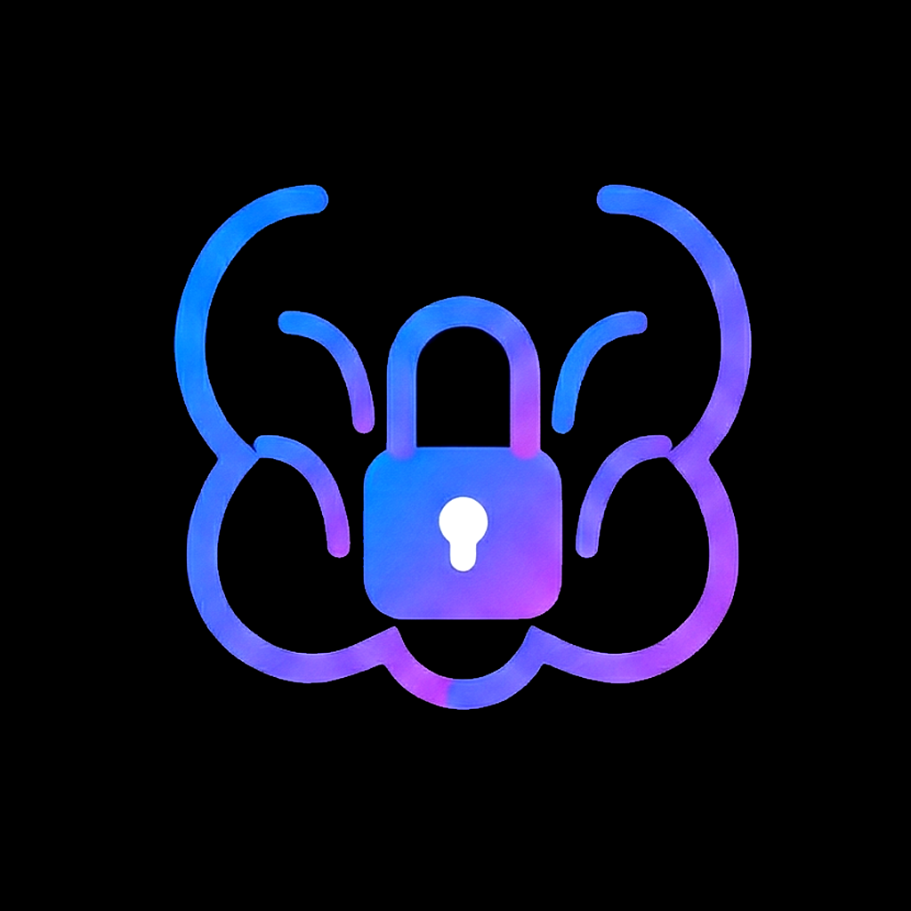
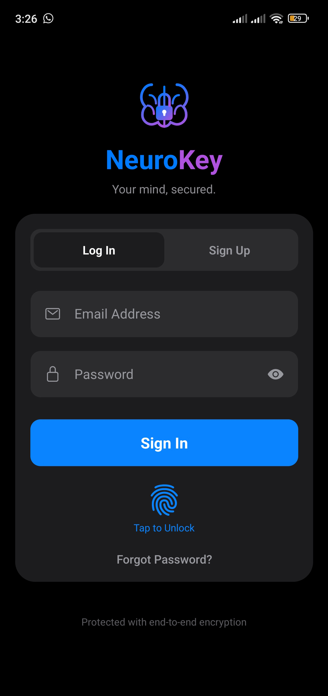
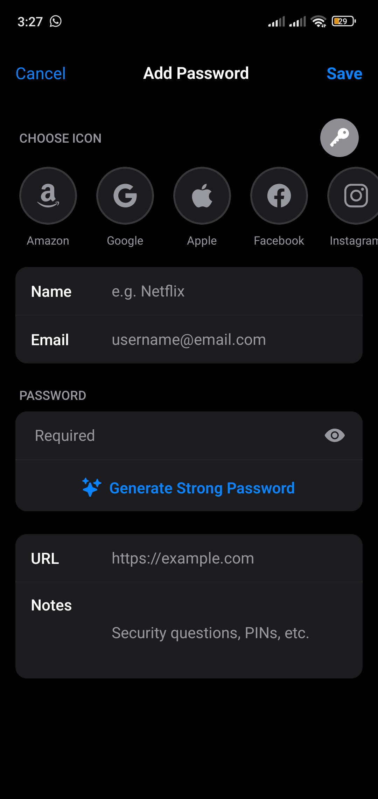
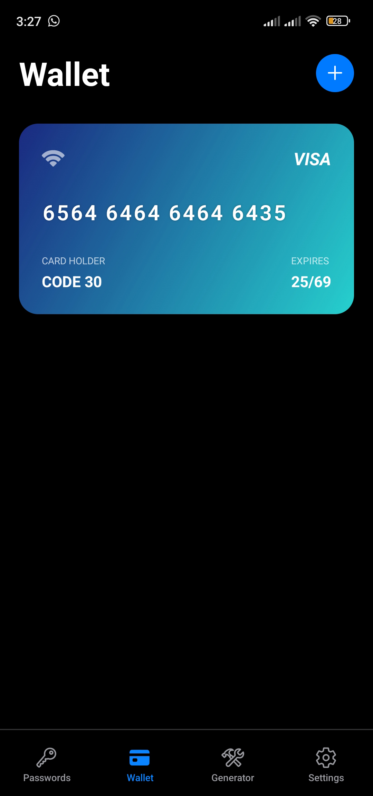
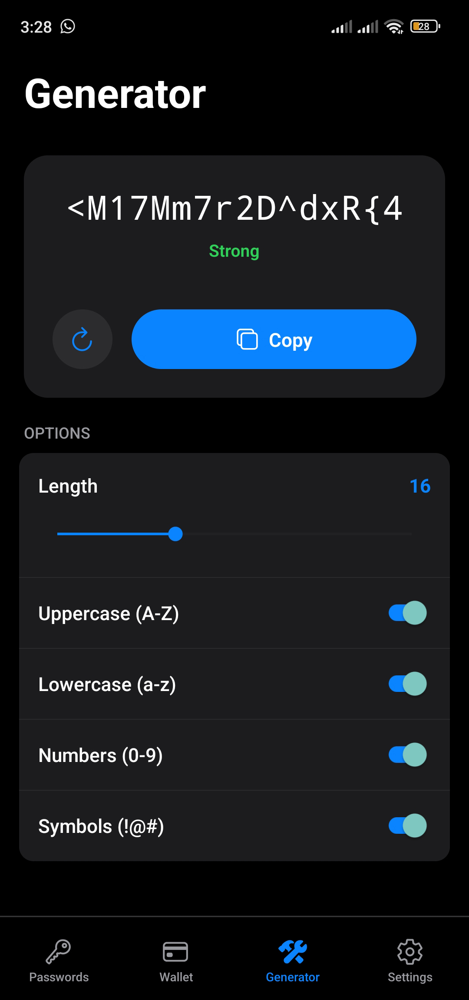
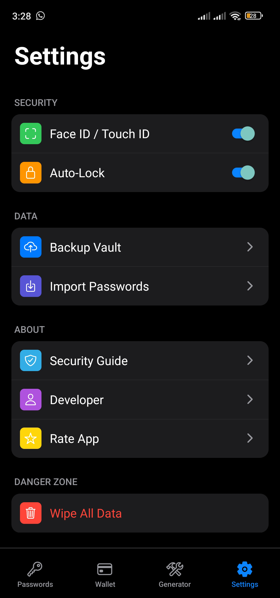

<div align="center">



# NeuroKey Mobile

**A password manager that keeps your secrets on your own devices.**

Passwords and payment cards, encrypted on your phone, unlocked with your fingerprint,
and synced to your computer over your own Wi-Fi.
No account server. No cloud. No subscription.

[](#-getting-started)
[](https://expo.dev/)
[](https://reactnative.dev/)
[](https://www.typescriptlang.org/)
[](#-how-your-data-is-protected)
[](#-biometric-unlock)
[](#-what-leaves-your-phone)

[Features](#-whats-inside) · [Why](#-why-neurokey) · [Security](#-how-your-data-is-protected) · [Device sync](#-device-sync-phone--desktop) · [Getting started](#-getting-started) · [Roadmap](#-roadmap)

<br />

&nbsp;
&nbsp;
&nbsp;
&nbsp;


</div>

---

## 🧠 Why NeuroKey

Most password managers ask for the same deal: hand your entire digital life
to their servers and trust that they'll never be breached, sold, or shut down.
For many people that trade is fine. NeuroKey exists for the people it isn't.

NeuroKey is the mobile half of a two-app ecosystem
([desktop](https://github.com/Ayoub-EDAHLOULI/neurokey-desktop) + Android). The
vault lives encrypted on your phone, and the only way it moves to another
device is a direct, encrypted transfer across your own local network,
started by you, by scanning a QR code.

| Principle | What it means for you |
| --- | --- |
| 🔐 **Only you hold the key** | Your master password is never stored anywhere, not even on your own phone. Without it, the vault is unreadable noise. |
| 👆 **Unlock with a touch** | Fingerprint or face unlock, backed by the Android Keystore. Your password is never saved to make this work. |
| 🏠 **Your data stays home** | There is no NeuroKey server. Nothing is uploaded, backed up, or "synced to the cloud". |
| 📶 **Sync without the internet** | Phone ↔ desktop transfer happens over your Wi-Fi, encrypted with a one-time key that only exists inside the QR code. |
| 🔒 **Locks itself** | Leave the app and come back: the vault is locked again and decrypted data is wiped from memory. |

---

## 🧰 What's Inside

<table>
<tr>
<td valign="top" width="50%">

### 🔑 Password Vault
- **Store logins**: name, username/email, password, website, notes
- **Instant search** across everything you've saved
- **Website icons** and quick picks for popular brands
- **One-tap copy** for usernames and passwords
- **Generate a strong password** right from the add form

### 💳 Digital Wallet
- **Save payment cards**: Visa, Mastercard, Amex
- **Realistic card previews** with brand styling
- **Copy card number / CVV** in one tap

### 🎲 Password Generator
- **Cryptographically secure** randomness from the OS
- Choose **length (8–32)** and **character sets** (A–Z, a–z, 0–9, symbols)
- **Live strength meter**: Weak / Good / Strong

</td>
<td valign="top" width="50%">

### 📡 Breach Radar
- **Automatic check** every time you open a password
- Shows **how many times** a password appeared in known breaches
- Uses *k-anonymity*: your password is never sent ([details](#-what-leaves-your-phone))

### 🔄 Device Sync
- **Scan the QR code** shown by NeuroKey Desktop
- **Local Wi-Fi only**: no internet, no relay server
- **Smart merge**: the newest version of each entry wins, and deletions sync too

### ⚙️ Settings & Safety
- **Biometric unlock** (fingerprint / face)
- **Auto-lock** whenever the app returns from the background
- **Wipe all data**: permanently erase the vault on this phone
- **Security guide** built right into the app
- **Light & dark mode** that follows your system

</td>
</tr>
</table>

---

## 🛡️ How Your Data Is Protected

> **In plain words:** your master password is turned into a key, that key locks
> your vault, and the key is thrown away the moment the vault locks. Nobody,
> including the people who wrote this app, can open your vault without your
> master password.

<details>
<summary><b>🔬 Technical details: vault format <code>nk2</code></b></summary>

<br />

The cryptography lives in [src/core/security/vaultCrypto.ts](src/core/security/vaultCrypto.ts)
and the unlock flow in [src/core/security/vaultAuth.ts](src/core/security/vaultAuth.ts).

| Layer | Implementation |
| --- | --- |
| **Key derivation** | PBKDF2-HMAC-SHA256, **100,000 iterations**, 128-bit random salt. Iteration count is stored per vault so it can be raised later (e.g. with a native KDF) without breaking existing vaults. |
| **Key separation** | Two sub-keys from the master key: `enc = HMAC-SHA256(master, "neurokey-enc")`, `mac = HMAC-SHA256(master, "neurokey-mac")` |
| **Encryption** | AES-256-CBC, fresh random 128-bit IV for every write |
| **Integrity** | Encrypt-then-MAC with HMAC-SHA256 over `nk2.<iv>.<ciphertext>`; tag compared in constant time. Any tampering → decryption refused. |
| **Payload format** | `nk2.<iv b64>.<ciphertext b64>.<tag b64>`, byte-compatible with NeuroKey Desktop |
| **Password check** | A known value encrypted with the key acts as a verifier. The master password and the derived key are **never written to disk**. |
| **Key material** | Salt, KDF parameters and verifier live in `expo-secure-store` (Android Keystore / iOS Keychain). |
| **Vault storage** | One encrypted blob in `AsyncStorage`. Nothing in it is readable without the key. |
| **In memory** | The key and decrypted items live only in RAM while unlocked; locking clears both. |
| **Randomness** | `crypto.getRandomValues` (OS CSPRNG), with rejection sampling in the generator to avoid modulo bias |
| **Legacy migration** | v1 vaults (5,000 iterations, no MAC, plain-JSON storage, stored password) are upgraded to `nk2` on the next successful unlock, and the old stored password is deleted. |

> Why 100k and not 600k like the desktop? PBKDF2 runs in pure JavaScript on
> Hermes, and 100k keeps a password unlock to a few seconds on a phone. Each
> vault records its own iteration count, so both apps can read each other's
> payloads regardless.

</details>

### 👆 Biometric Unlock

When you turn on fingerprint / face unlock, NeuroKey stores the **vault key**
(never your password) in a secure-store item that Android only releases after
a successful biometric check. If your enrolled fingerprints change, the OS
invalidates that item and NeuroKey falls back to your master password.

---

## 🔄 Device Sync (Phone ↔ Desktop)

Syncing never touches the internet. Both devices must be on the same Wi-Fi.

```text
 ┌──────── NeuroKey Desktop ─────────┐                ┌──────────── Phone ─────────────┐
 │ 1. Generates a one-time session id│                │                                │
 │    + a random 256-bit key         │   QR code      │ 2. Scans the QR code with the  │
 │    and shows them in a QR code ───┼───(on screen)──┼─▶  camera (key never sent over │
 │                                   │                │    the network)                │
 │ 4. Checks the session id, swaps   │◀── encrypted ──┤ 3. Sends its vault, encrypted  │
 │    vaults                         │─── encrypted ─▶│    with the session key        │
 │                                   │   local Wi-Fi  │ 5. Verifies, decrypts, merges  │
 └───────────────────────────────────┘                └────────────────────────────────┘
```

**For everyone:** the QR code is a one-time, five-minute pass. Anyone else on
your Wi-Fi only ever sees scrambled data, because the key to unscramble it was
shown on your screen, never sent across the network.

<details>
<summary><b>🔬 Technical details</b></summary>

<br />

The phone side lives in [app/sync.tsx](app/sync.tsx).

- The QR code carries `{ v: 2, url, sid, key }`: the desktop's local address,
  a 128-bit session id and a 256-bit session key. Anything else is rejected.
- The phone pings the desktop, then `POST`s its vault to `/sync` with the
  session id in the `X-NeuroKey-Session` header.
- Both vaults travel encrypted + authenticated with the session key (`nk2`
  format). A response that fails the HMAC check is refused.
- Merging is last-write-wins per entry (`updated_at`). Deleted entries are
  kept as tombstones (`isDeleted`) so deletions propagate between devices.
- The camera is only used to read the QR code. Nothing is recorded or stored.

</details>

---

## 🌐 What Leaves Your Phone

Honesty over marketing: NeuroKey has no server of its own, but two features
do reach the internet. Here is exactly what they send.

| Feature | Goes to | What is sent | What is **never** sent |
| --- | --- | --- | --- |
| **Breach Radar** | `api.pwnedpasswords.com` (Have I Been Pwned) | The first **5 characters** of the password's SHA-1 hash. The check is completed on the phone. | Your password, or its full hash |
| **Website icons** | Google's favicon service | The **domain name** of the website you saved (e.g. `github.com`) | Usernames, passwords, notes, cards |
| **Device sync** | Your computer, on your local network only | Your vault, encrypted with a one-time key | Anything readable |

Everything else (unlocking, encrypting, generating, searching, auto-lock)
happens entirely offline.

---

## 🚀 Getting Started

### Prerequisites

- [Node.js](https://nodejs.org/) (LTS)
- [Android Studio](https://developer.android.com/studio) with an emulator, or an Android phone with USB debugging
- Optional: [EAS CLI](https://docs.expo.dev/build/setup/) (`npm i -g eas-cli`) for cloud builds

### Run in development

```bash
git clone https://github.com/Ayoub-EDAHLOULI/NeuroKey.git
cd NeuroKey
npm install
npx expo run:android
```

> 💡 Use a development build (`expo run:android`) rather than Expo Go:
> biometric-protected secure storage and the camera need the app's own
> native configuration.

### Build an APK / release

```bash
eas build -p android --profile preview      # installable APK
eas build -p android --profile production   # Play Store bundle
```

### First launch

1. **Sign up**: enter your email and a master password.
2. **Remember that password.** It is the only key to your data, and nobody can reset it for you.
3. Turn on **Face ID / Touch ID** in Settings for one-tap unlock.
4. Add passwords and cards, or open **Settings → Sync with Desktop** to pull them from your computer.

---

## 🏗️ Tech Stack

| Layer | Technology |
| --- | --- |
| Framework | [Expo SDK 54](https://expo.dev/) + [React Native 0.81](https://reactnative.dev/) (New Architecture, Hermes) |
| Language | [TypeScript](https://www.typescriptlang.org/) |
| Navigation | [Expo Router](https://docs.expo.dev/router/introduction/) (file-based) |
| State | React Context |
| Secure storage | `expo-secure-store` (Keystore / Keychain) + `AsyncStorage` (encrypted vault) |
| Biometrics | `expo-local-authentication` |
| Crypto | `crypto-js` (PBKDF2, AES, HMAC) + `react-native-get-random-values` (CSPRNG) + `expo-crypto` (SHA-1) |
| QR scanning | `expo-camera` |
| Animations | `react-native-reanimated` |

### Project structure

```text
app/
├── (tabs)/              # Passwords, Wallet, Generator, Settings
├── auth.tsx             # sign up / unlock (password or biometrics)
├── sync.tsx             # QR scan + encrypted sync with the desktop
├── add.tsx, edit.tsx, detail.tsx               # password entries
├── add-card.tsx, edit-card.tsx, card-detail.tsx # payment cards
└── _layout.tsx          # root stack + auto-lock listener
src/
├── core/security/
│   ├── vaultCrypto.ts   # nk2 format: key derivation, AES + HMAC, CSPRNG
│   ├── vaultAuth.ts     # create / unlock vault, biometric key, v1 migration
│   └── breachCheck.ts   # Have I Been Pwned k-anonymity lookup
├── context/
│   └── VaultContext.tsx # in-memory vault, encrypts on every change
└── components/          # Credit card, password row, icons, alerts
```

---

## 🗺️ Roadmap

<details>
<summary><b>Core vault</b> ✅</summary>

- [x] Master-password vault with encrypted local storage
- [x] Passwords: add, view, edit, delete, search
- [x] Digital wallet for payment cards
- [x] Secure password generator with strength meter
- [x] Biometric unlock
- [x] Auto-lock on return from background
- [x] Wipe all data

</details>

<details>
<summary><b>Security hardening</b> ✅</summary>

- [x] Vault format `nk2`: PBKDF2 + AES-256 + HMAC (encrypt-then-MAC)
- [x] Transparent migration of v1 vaults
- [x] Biometric unlock stores the vault key, never the password
- [x] Bias-free CSPRNG password generation
- [x] Breach Radar with k-anonymity

</details>

<details>
<summary><b>Ecosystem</b> 🚧</summary>

- [x] QR-code pairing with NeuroKey Desktop
- [x] One-time, end-to-end encrypted local sync
- [x] Smart merge with deletion tombstones
- [ ] Native KDF to raise PBKDF2 iterations to match desktop
- [ ] Encrypted backup / export
- [ ] Import passwords from other managers
- [ ] Change master password
- [ ] Secure notes
- [ ] Clipboard auto-clear
- [ ] Configurable auto-lock delay
- [ ] Autofill service
- [ ] iOS release

</details>

---

## 🤝 Contributing

Issues and pull requests are welcome. Two ground rules:

- **No new network calls** without a clear, user-visible reason, and an entry
  in [What Leaves Your Phone](#-what-leaves-your-phone).
- **Don't break the `nk2` format.** It must stay byte-compatible with
  NeuroKey Desktop, since each app reads the other's sync payloads.

Found a security issue? Please report it privately rather than opening a public issue.

<div align="center">
<br />
<sub>Your keys. Your devices. Your network. 🧠</sub>
</div>
